# What the cartridge draws

Under each picture is where it comes from and what is on it.

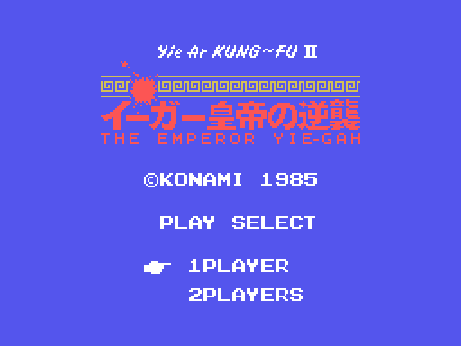

*The title screen, built by 0x4CE9 and placed by 0x4D10. Checked against openMSX's VRAM: <b>768 of 768 tiles identical</b>.*

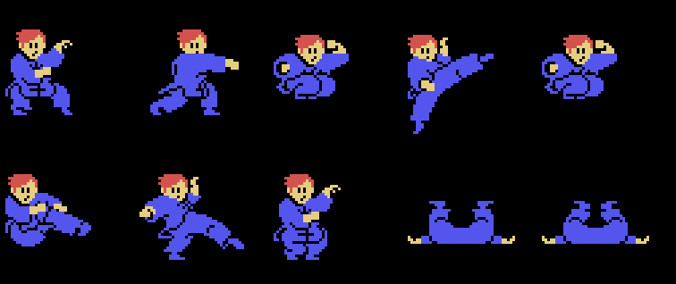

*LEE YOUNG's ten poses, each assembled from its four header sprites, its triples and the scripts that upload its patterns.*

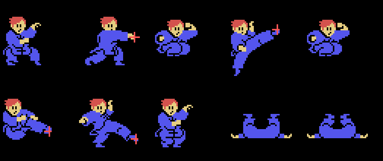

*The same ten poses, with a cross on the FOURTH box of the script: the point where that blow lands. Only four carry it -the four attacks- and it is the point 0x7402 compares against the soup's spot. The cross is ours; the point comes from the script.*

*The two items that drop, drawn from the ROM: the <b>soup bowl</b> (pattern 0xDC, the invulnerability one) and the <b>drink</b> (pattern 0xE0, the sibling-cartridge one). They come from the loose script at 0xA7D1, not from the sixteen player ones.*

*The sign for the sibling-cartridge reward: the 4x3 tile figure at 0x7525, which 0x751B places at row 6, column 14.*

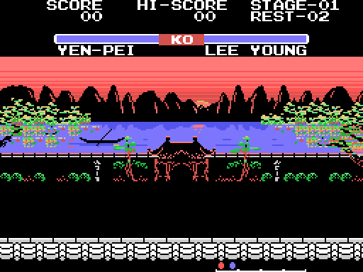

*Scenery 1, against YEN-PEI. Scenery, floor and rival come from different tables indexed by the round.*

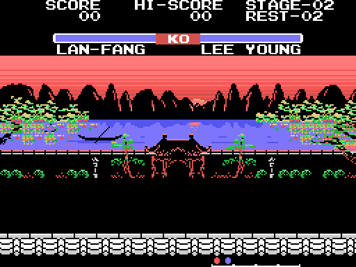

*Scenery 2, against LAN-FANG: same backdrop as 1, a different floor.*

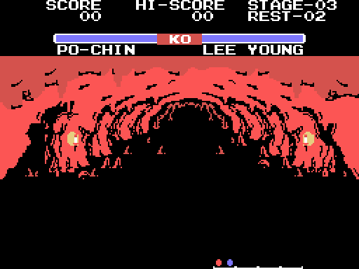

*Scenery 3, against PO-CHIN.*

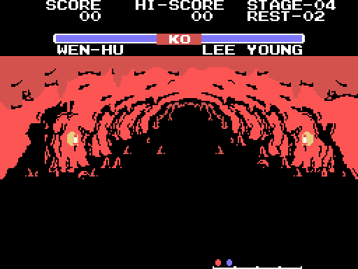

*Scenery 4, against WEN-HU. The only one with a phase marker: the <code>cp 003h</code> at 0x5A7A.*

*Scenery 5, against WEI-CHIN.*

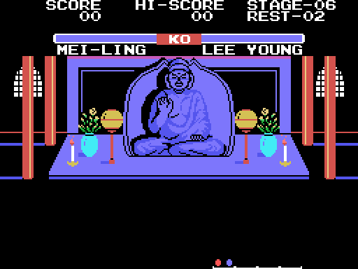

*Scenery 6, against MEI-LING.*

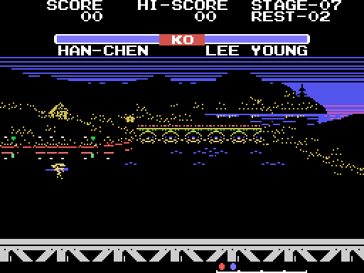

*Scenery 7, against HAN-CHEN: the night one, with lanterns.*

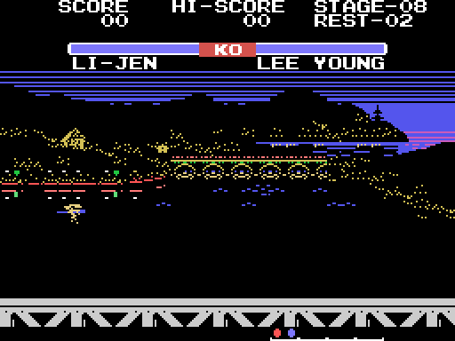

*Scenery 8, against LI-JEN, the emperor Yie-Gah.*

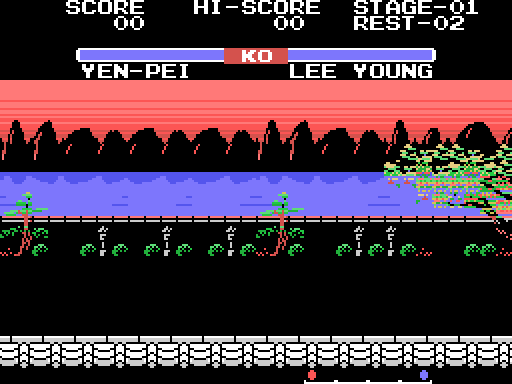

*First wave of the backdrop of sceneries 1-2: eight vertical slices of landscape four tiles wide, picked by the eight nibbles at 0x5BF0. Its tiles are the fight screen's own bands.*

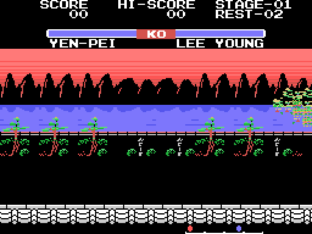

*Second wave, sceneries 1-2.*

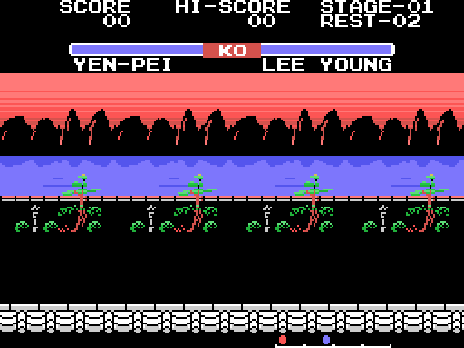

*Third wave, sceneries 1-2.*

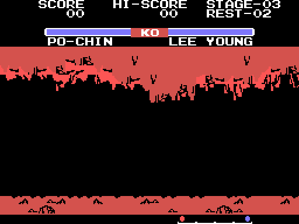

*First wave, sceneries 3-4.*

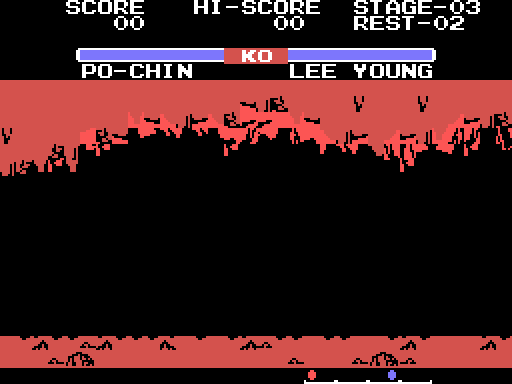

*Second wave, sceneries 3-4: the whole landscape in order, slices 0 to 7.*

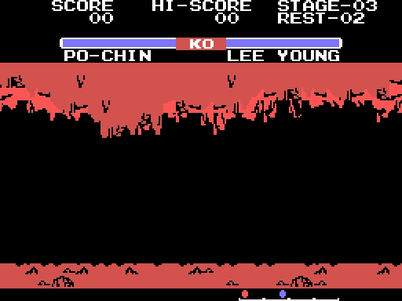

*Third wave, sceneries 3-4.*

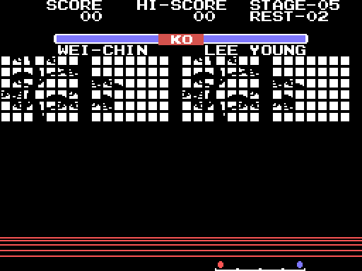

*First wave, sceneries 5-6.*

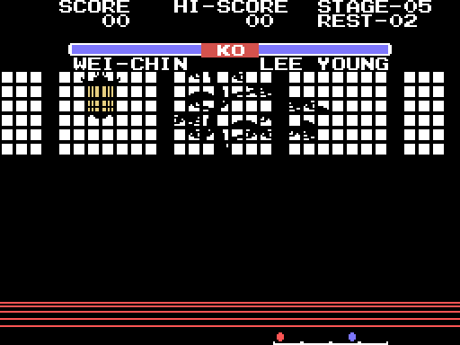

*Second wave, sceneries 5-6.*

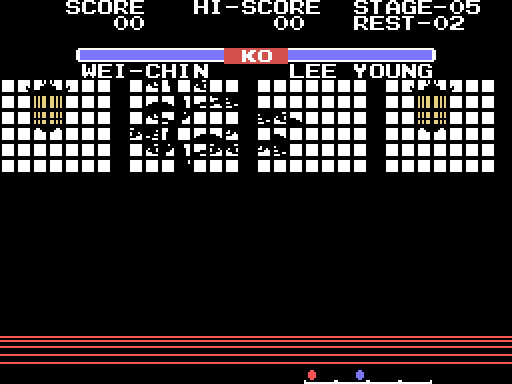

*Third wave, sceneries 5-6.*

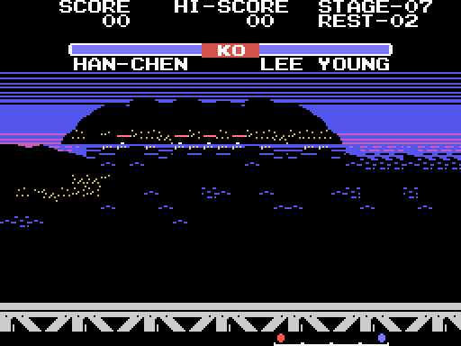

*First wave, sceneries 7-8: the landscape slides eight columns right on each screen.*

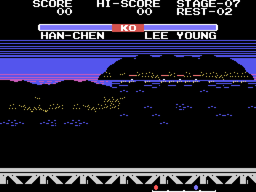

*Second wave, sceneries 7-8.*

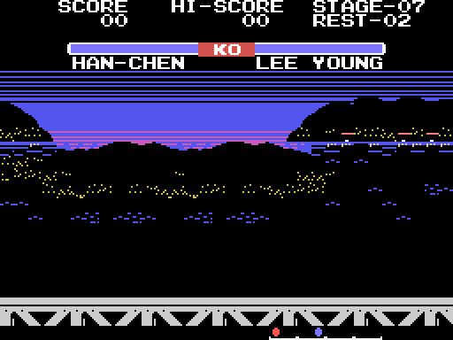

*Third wave, sceneries 7-8.*

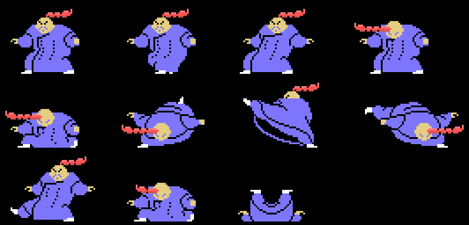

*YEN-PEI, all eleven figures. The rivals are not sprites: they are TILES, and each figure carries its height, width and compressed tiles.*

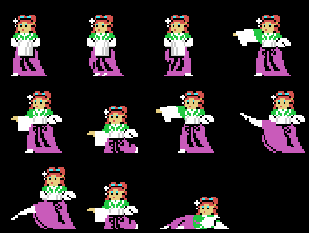

*LAN-FANG.*

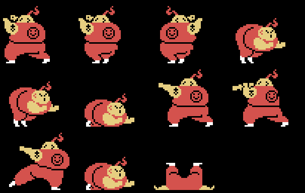

*PO-CHIN.*

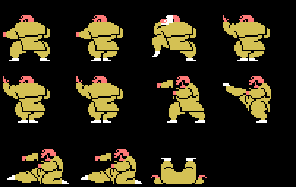

*WEN-HU.*

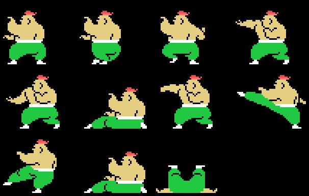

*WEI-CHIN.*

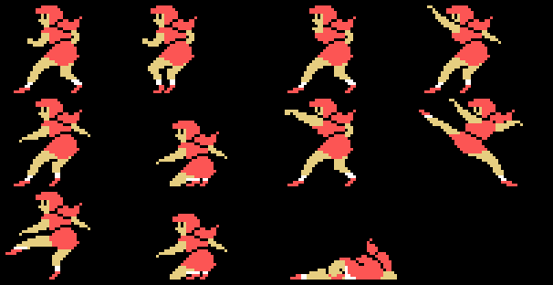

*MEI-LING.*

*HAN-CHEN.*

*LI-JEN, the emperor Yie-Gah.*

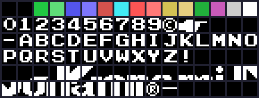

*The in-house font, uploaded by 0x4A8D to all three thirds: space at 0x00, digits from 0x10 and letters from 0x21.*

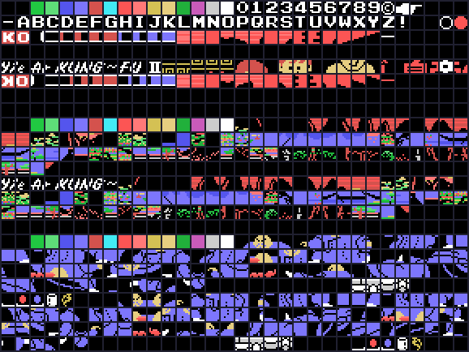

*The 256 tiles of the first scenery in all three banks, exactly as they sit in VRAM after the mirror.*
