# Lo que el cartucho dibuja

Debajo de cada imagen esta de donde sale y que se esta viendo.

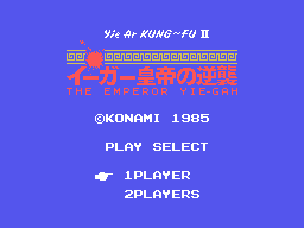

*La pantalla del titulo, montada por 0x4CE9 y colocada por 0x4D10. Cotejada contra la VRAM de openMSX: <b>768 de 768 casillas iguales</b>.*

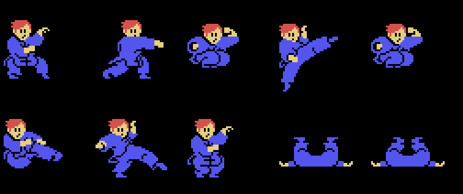

*Las diez poses de LEE YOUNG, cada una montada con sus cuatro sprites de cabecera, sus trios y los guiones que suben sus patrones.*

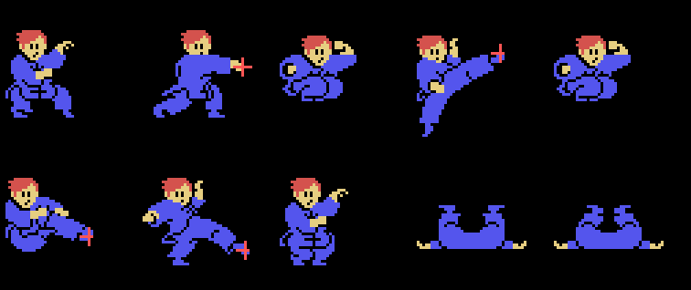

*Las mismas diez poses, con una cruz en la CUARTA caja del guion: el punto por el que ese golpe toca. Solo la tienen cuatro -los cuatro ataques-, y es el punto que 0x7402 compara con el sitio de la sopa. La cruz la ponemos nosotros; el punto sale del guion.*

*Las dos piezas que caen, dibujadas desde la ROM: el <b>cuenco de sopa</b> (patron 0xDC, el de la invulnerabilidad) y el <b>refresco</b> (patron 0xE0, el del cartucho hermano). Los sube el guion suelto de 0xA7D1, no los dieciseis del muneco.*

*El cartel del premio del cartucho hermano: la figura de 4x3 casillas de 0x7525, que 0x751B pone en la fila 6, columna 14.*

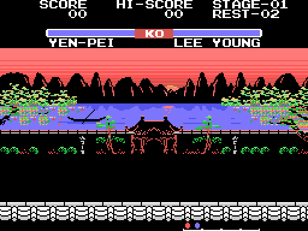

*Escenario 1, contra YEN-PEI. El decorado, el suelo y el rival salen de tablas distintas indexadas por la ronda.*

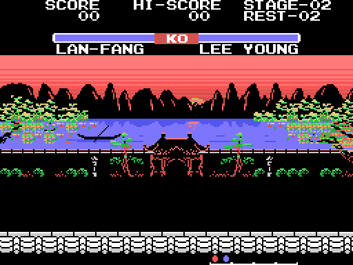

*Escenario 2, contra LAN-FANG: mismo decorado que el 1, otro suelo.*

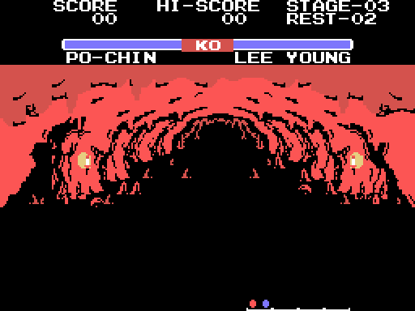

*Escenario 3, contra PO-CHIN.*

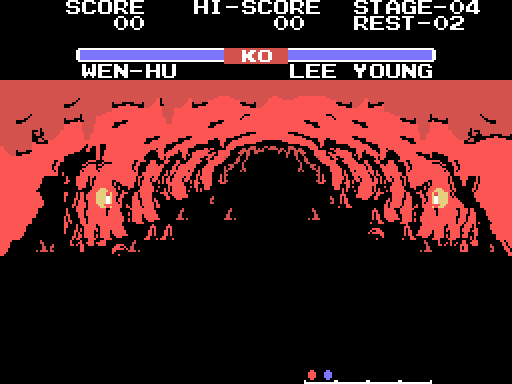

*Escenario 4, contra WEN-HU. Es el unico que lleva marcador de fase: el <code>cp 003h</code> de 0x5A7A.*

*Escenario 5, contra WEI-CHIN.*

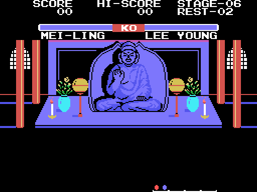

*Escenario 6, contra MEI-LING.*

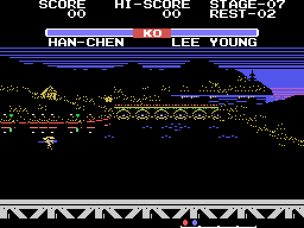

*Escenario 7, contra HAN-CHEN: el nocturno, con los faroles.*

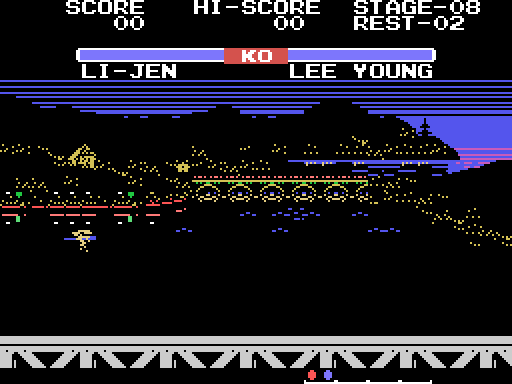

*Escenario 8, contra LI-JEN, el emperador Yie-Gah.*

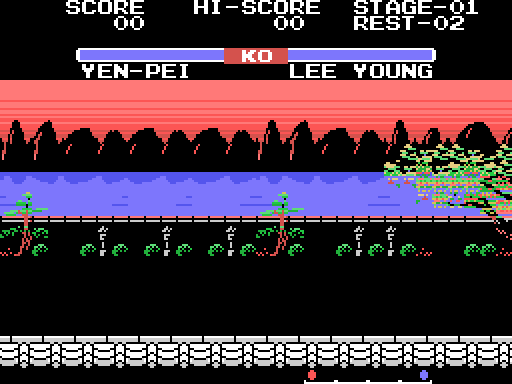

*Primera oleada del decorado de los escenarios 1-2: ocho tiras verticales de paisaje de cuatro casillas, elegidas por los ocho nibbles de 0x5BF0. Sus casillas son las bandas del propio combate.*

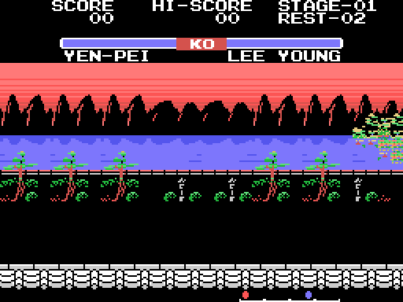

*Segunda oleada, escenarios 1-2.*

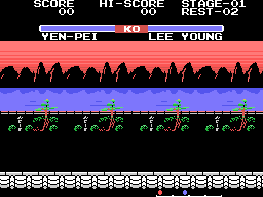

*Tercera oleada, escenarios 1-2.*

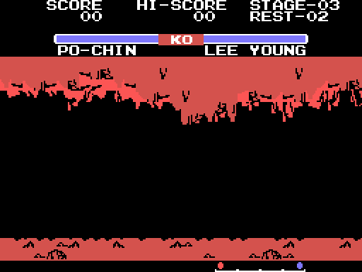

*Primera oleada, escenarios 3-4.*

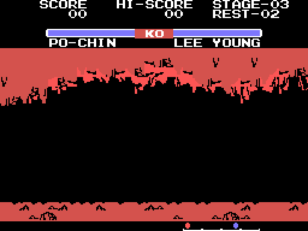

*Segunda oleada, escenarios 3-4: el paisaje entero en orden, tiras 0 a 7.*

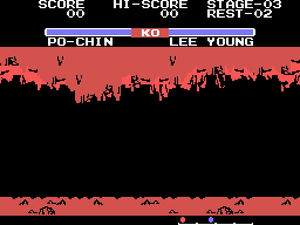

*Tercera oleada, escenarios 3-4.*

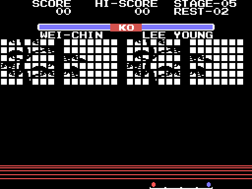

*Primera oleada, escenarios 5-6.*

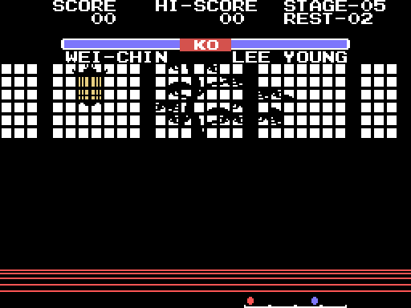

*Segunda oleada, escenarios 5-6.*

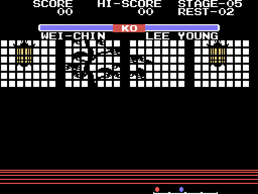

*Tercera oleada, escenarios 5-6.*

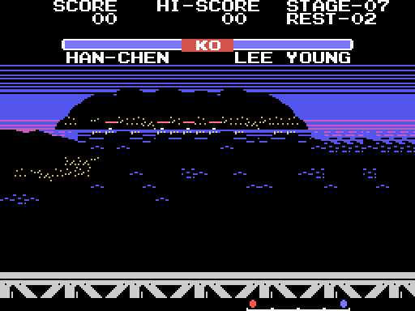

*Primera oleada, escenarios 7-8: el paisaje se corre ocho columnas a la derecha en cada pantalla.*

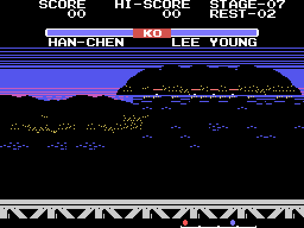

*Segunda oleada, escenarios 7-8.*

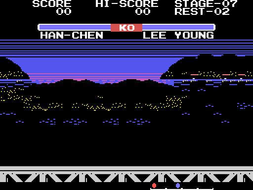

*Tercera oleada, escenarios 7-8.*

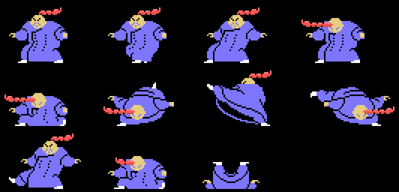

*YEN-PEI, sus once figuras. Los rivales no son sprites: son CASILLAS, y cada figura trae su alto, su ancho y sus casillas comprimidas.*

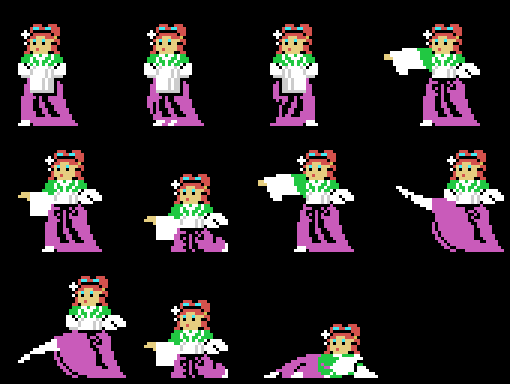

*LAN-FANG.*

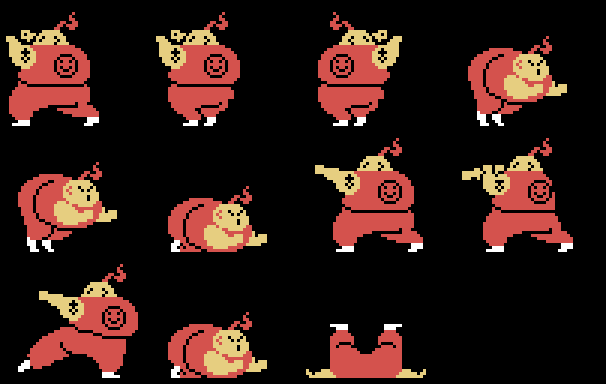

*PO-CHIN.*

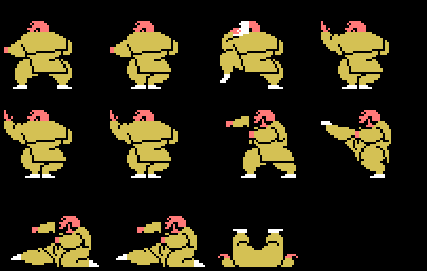

*WEN-HU.*

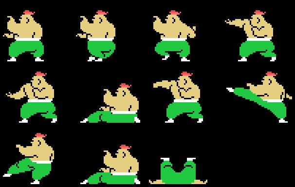

*WEI-CHIN.*

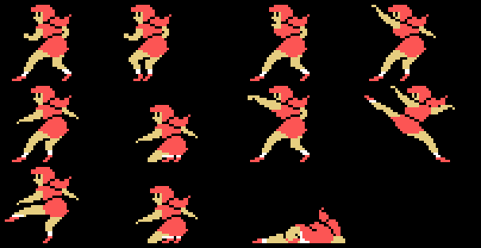

*MEI-LING.*

*HAN-CHEN.*

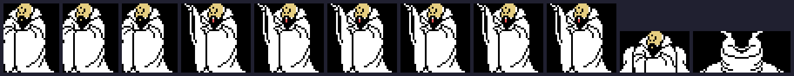

*LI-JEN, el emperador Yie-Gah.*

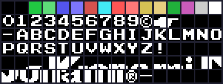

*La fuente de la casa, subida por 0x4A8D a los tres tercios: el espacio en 0x00, las cifras desde 0x10 y las letras desde 0x21.*

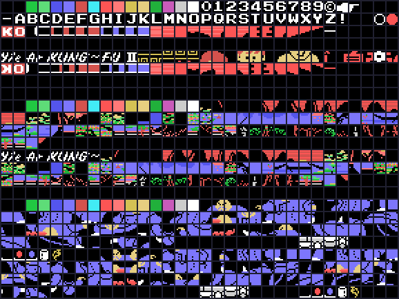

*Las 256 casillas del primer escenario en sus tres bancos, tal y como quedan en la VRAM despues del espejo.*
